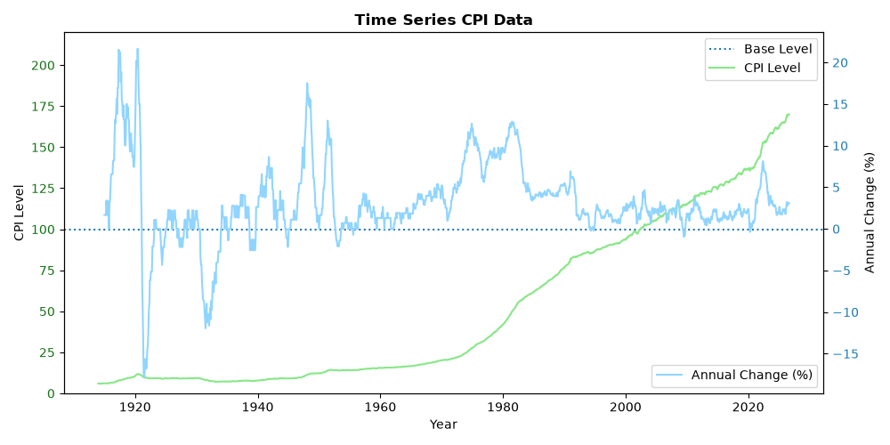

# FINE3300-2026-A2
Creating a CPI calculator using real Bank of Canada data files, alongside NumPy, Matplotlib and Pandas libraries. Assignment 2 of my Finance for Python Professionals class.
# Consumer Price Index (CPI)
This repository, which you seemed to have stumbled upon, was created for my second assignment in my FINE3300 - Python for Finance Professionals course at the Schulich School of Business. The assignment had two major components, which will each be summarized and explained in their own sections to follow. To introduce them, I needed to create a CPI-based graph and a specialized inflation calculator. The files with the final codes, the time series graph, the CPI information and the project breakdown are all attached to the repository.
Keep in mind, as you go through the code and files, that currencies are in Canadian dollars and that the values used in graphing and calculating are directly from the Bank of Canada website/CSV file.

**IMPORTANT USER NOTE: Keep the BankofCanadaFile.csv in the same folder as the time series and calculator Python codes/scripts when using them. Make sure to run the code from the folder with all of the files together. Otherwise, the data file might not be found.**

I hope you are able to learn from my code, or even possibly enjoy using it. For example, maybe you want to find out how much more you are paying for your McDonald's Big Mac today, comapred to 50 years ago! Who am I kidding? No one would get any value out of that... right?

Repository URL: https://github.com/erania4/FINE3300-2026-A2.git

## Time Series Figure - Part One
This was the first part of the assignment. It required me to create a dual axis time series graph, plotting the CPI level and its percentage change on an annual basis over time.
### Reading and Understanding
First, I read the CSV file using Pandas, displayed it and printed some information to better understand what I was dealing with, and then worked on plotting it as necessary.
### Calculating and Defining
I originally began with an idea using NumPy, but when that seemed to limiting I resorted to datetime in Pandas, which allowed me to plot my values over time using the file's data. Plotting the CPI levels would be simple from there on. The next part was determining how to calculate the annual percentage changes. This stumped me at first, but after researching Pandas documentation I learned of a way to compute the percent change from my data, on a periodic basis - just what I needed.
### Plotting
Finally, I setup my figure and plotted the data accordingly. I read Matplotlib documentation about plots that used different y-axes but shared the same x-axis. I also had to add a base line at the CPI's base level. I then put everything together and plotted the final graph; one that I am quite proud of and happy with.

### Analysis
Uninterestingly, the CPI level has risen relatively smoothly and consistently since being tracked and recorded in Canada in 1914. The annual change, on the other hand, has some interesting movements to take note of. For instance, there was a large rise in annual percentage change (inflation) leading up to and during World War One, but just after there was an incredibly large and sharp decline just afterwards. Looking more recently in the 2020s, we can see how growth slowed at the beginning of the COVID-19 Pandemic but rose sharply afterward as the government attempted to inspire spending and boost the economy. With that, prices started going up as well eventually bringing everything to a more steady pace over the last few years. Also, it does inspire wonder that the base line is crossed by the CPI Level line in 2002 of all years. 
## Enhanced CPI/Inflation Calculator - Part Two
For the second major division of the assignment, I needed to enhance the Bank of Canada's inflation calculator and produce deeper results while validating inputs. To enhance the calculator, I needed to allow for monthly inputs while the Bank of Canada's inflation calculator only allows for changes in years.
### Inputs
In prompting the user to provide the necessary parameters, I coded for input values to be used upon running the code. 
In preparing for many different case scenarios, I also provided plenty of formatting in an attempt to validate my code and allow for anyone's minor errors to go unnoticed and not make any difference whatsover. Of course, there are errors that cannot be accounted for completely, but I tried to make it easier for the user wherever I could.
### Functions
Within the code, I used two different functions. Within the two functions lies the primary calculations and user returns.
The first function is the one that locates the CPI level, based on the dates that the user inputs. This was one of the trickier parts of the entire code. To access and use the specifically requested year and month's data from the file, I created a code that located the value using the index associated with the exact year and month that the user inputted. After ensuring that the inputted datetime year and month are in the dataset, it is used as a key to access the specific CPI value that is being called upon for the calculations.
The second function performs all of the calculations that the Bank of Canada's inflation calculator provides. It also prints specifically formatted messages for each of the returns, all based on the values inputted by the user. 
### Example Output
>Please enter the date of the first period (YYYY-MM): 1914-09
>
>Enter the second date (YYYY-MM): 2026-09
>
>Enter the cost of the "basket" at the first date (with no formatting): 100
>
>----------------------------------------------------------------------------------------------------
>
>A "basket" of goods and services that cost $100.00 (CAD) in September 1914, would cost $2,833.33 (CAD) in September 2026!
>
>The percent change totalled: 2,733.33%.
>
>This is equal to a rate of 3.03%, compounded annually over 112 years.
>
>The CPI for September 1914 is 6.0, while the CPI for September 2026 is 170.0.
>
>----------------------------------------------------------------------------------------------------
I used September in my example output because, since I am writing this in November, the file's most recent date is from the month of September and so the Bank of Canada's calculator automatically uses informaiton from September.
Note, to use 
## Repository Files
As you may have already seen, attached to the GitHub repository is an accumulation of all of my coding and process work, the png image of the time series graph and the Bank of Canada's CSV file from which I derived all of my data.
Feel free to take a look through my code, interact with it or even replicate it on your own and run my code. There are plenty of comments dispersed throughout the coding files, which will help you understand my entire process as you walk-through the code I designed.
## Resources Consulted
- https://pandas.pydata.org/docs/reference/api/pandas.read_csv.html
- https://python-charts.com/matplotlib/dates/
- https://pandas.pydata.org/docs/reference/api/pandas.to_datetime.html
- https://pandas.pydata.org/docs/reference/api/pandas.Series.dt.month.html
-  https://stackoverflow.com/questions/25146121/extracting-just-month-and-year-separately-from-pandas-datetime-column
- https://pandas.pydata.org/docs/reference/api/pandas.Series.dt.year.html
- https://pandas.pydata.org/docs/reference/api/pandas.DataFrame.pct_change.html
- https://matplotlib.org/stable/gallery/subplots_axes_and_figures/two_scales.html
- https://matplotlib.org/stable/api/_as_gen/matplotlib.axes.Axes.plot.html#matplotlib.axes.Axes.plot
- https://matplotlib.org/stable/api/_as_gen/matplotlib.pyplot.hlines.html
- https://matplotlib.org/stable/api/_as_gen/matplotlib.pyplot.axhline.html#matplotlib.pyplot.axhline
- https://matplotlib.org/stable/api/_as_gen/matplotlib.pyplot.ylim.html
- https://matplotlib.org/stable/api/_as_gen/matplotlib.axes.Axes.legend.html#matplotlib.axes.Axes.legend
- https://matplotlib.org/stable/users/explain/axes/legend_guide.html#controlling-the-legend-entries
- https://matplotlib.org/stable/api/_as_gen/matplotlib.pyplot.savefig.html
- https://pandas.pydata.org/docs/user_guide/indexing.html
- https://pandas.pydata.org/docs/user_guide/timeseries.html
- https://docs.python.org/3/library/datetime.html

### Thank you, enjoy and (as always) happy coding!